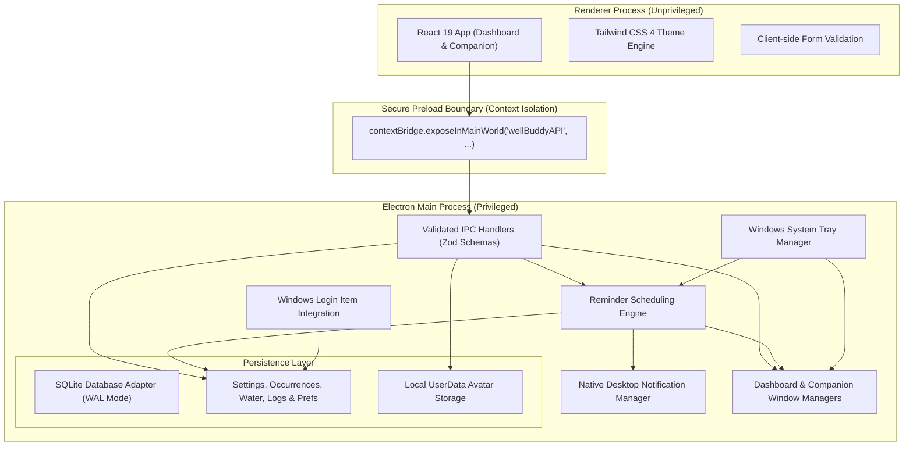
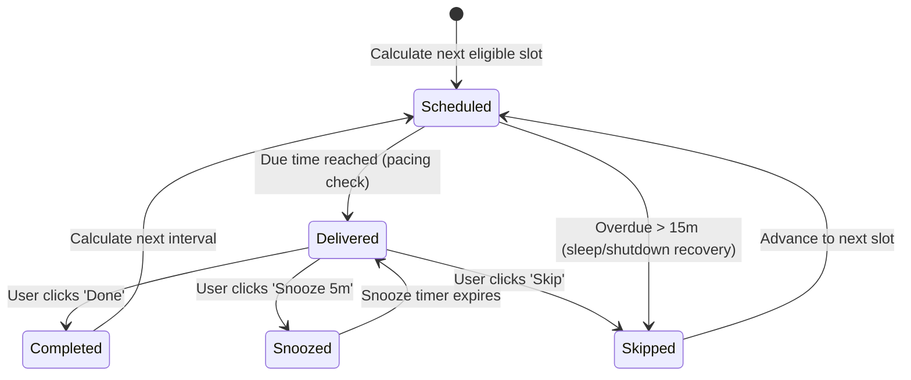
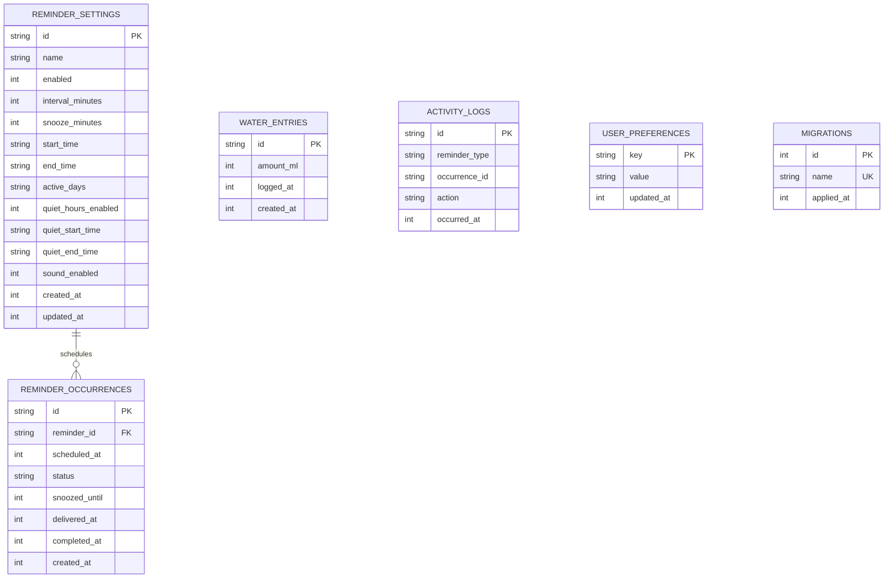

# WellBuddy — Architecture & System Design Document

This document outlines the architectural decisions, subsystem boundaries, data models, and lifecycle mechanisms implemented in the **WellBuddy Desktop Wellness Companion**.

---

## 1. Process Separation & Security Model

WellBuddy strictly adheres to Electron's security best practices, enforcing process isolation between the native Node runtime and the web browser context.

### Security Directives
1. **Context Isolation**: `contextIsolation: true` is strictly enforced on all `BrowserWindow` instances.
2. **Node Integration Disabled**: `nodeIntegration: false` prevents any renderer script from accessing Node APIs (`fs`, `child_process`, `os`).
3. **Restricted Sandbox**: Windows are sandboxed; access to local storage is mediated exclusively through validated IPC calls.
4. **Content Security Policy (CSP)**: Injected HTTP header restricting scripts and stylesheets to `'self' 'unsafe-inline'` and image sources to `'self' data: blob:`. Remote scripts are forbidden.
5. **Window Navigation Interception**: `setWindowOpenHandler` denies all unauthorized window opens, and `will-navigate` halts any unapproved external navigation.

---

## 2. Core Reminder Engine & Occurrence Idempotency

The reminder system operates continuously in the background, independent of the dashboard window lifecycle or companion visibility.

### A. Lifecycle State Machine

### B. Idempotency Guarantees
- **Deterministic Identity**: Each occurrence has a deterministic primary key format: `{reminderType}_{scheduledTimestamp}`.
- **Single Processing Guarantee**: Once an occurrence transitions to `completed`, any subsequent completion or snooze request for that occurrence is an idempotent no-op.
- **Snooze Semantics**: Snoozing updates `snoozed_until` on the existing occurrence row rather than creating a duplicate, ensuring that historical records reflect the true single instance.
- **Recovery Policy**: If the machine wakes from sleep or was turned off for several hours, any scheduled occurrence older than 15 minutes is automatically marked `skipped` in bulk, eliminating "notification floods".
- **Anti-Storm Delivery**: If multiple reminders become due at the exact same millisecond, an anti-storm throttle spaces out deliveries by 2.5 seconds, preventing desktop toast spam.

### C. Schedule Eligibility (Working & Quiet Hours)
Before scheduling an occurrence, the scheduler checks:
1. **Active Days**: Checks if the target day is in `workingHours.activeDays` (e.g. Mon–Fri).
2. **Working Window**: If target time is after `workingHours.endTime`, the occurrence jumps forward to tomorrow's `startTime`.
3. **Quiet Hours**: If quiet hours are enabled and target time falls inside `quietHours`, the occurrence is shifted to `quietHours.endTime`.

---

## 3. Database Schema & Persistence Strategy

All persistent data is stored in SQLite at `%APPDATA%\WellBuddy\wellbuddy.db` with Write-Ahead Logging (`WAL`) and foreign keys enabled.

---

## 4. Desktop Windows & System Tray Lifecycle

1. **Dashboard Window**:
   - Primary management interface.
   - On close (`'close'` event), default behavior cancels close and calls `.hide()`, minimizing the application to the Windows system tray.
   - Full exit occurs only when explicitly selected via **Exit Application** in the system tray or settings.
2. **Floating Companion Window**:
   - Frameless, transparent, always-on-top window.
   - Draggable across the desktop using `-webkit-app-region: drag`.
   - Action buttons and inputs are protected with `-webkit-app-region: no-drag`.
   - Bounds validation ensures the companion stays within visible monitor coordinates.
   - Position is saved to SQLite on the `'moved'` event.
   - Hiding the companion never interrupts background reminder timers.
3. **Windows System Tray**:
   - Context menu provides instant actions: Open Dashboard, Toggle Companion Visibility, Pause/Resume (1 hour), Next Due Reminder status, Settings, and Quit.
4. **Windows Startup**:
   - Configured via `app.setLoginItemSettings({ openAtLogin: true, path: process.execPath, args: ['--hidden'] })`.
   - Enabled by default on first launch.
   - Subsequent user preference changes are persisted in `user_preferences`.

---

## 5. Avatar System

1. **Built-in Mascots**:
   - Four embedded SVG vector assets (Aqua the Droplet, Sprout the Seedling, Bolt the RoboBuddy, and Zen the Pebble).
   - Rendered natively with zero remote URL dependencies.
2. **Custom Uploaded Avatars**:
   - Accepted formats: PNG, JPG/JPEG, WebP (up to 5MB).
   - Validation checks MIME types and validates binary magic bytes (e.g. `0x89 0x50 0x4E 0x47` for PNG).
   - Saved with sanitized UUIDs into `%APPDATA%\WellBuddy\avatars\`.
   - Graceful fallback to default avatar if a custom file is missing.
